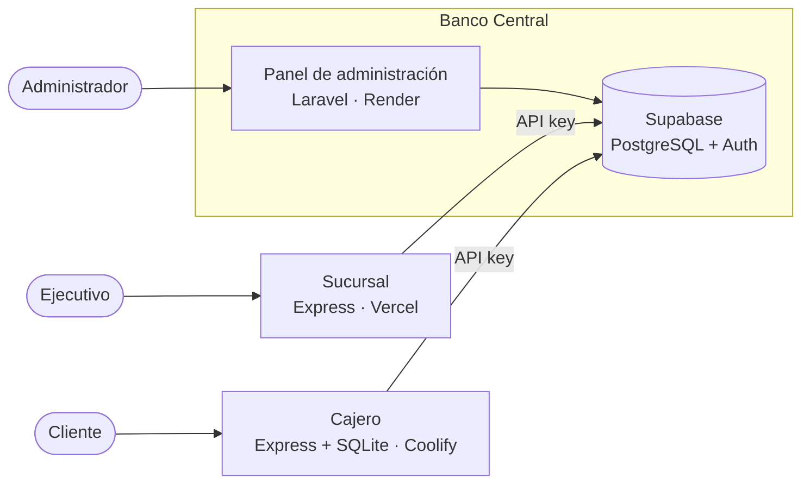

# Cajero automático

Nodo cajero del sistema bancario distribuido (Examen 2, Tópicos de Desarrollo Web).
Los clientes consultan su saldo, retiran y depositan. Antes de un retiro el cajero revisa que
tenga efectivo suficiente; si no, rechaza la operación sin llamar al Banco Central. La API key
y el efectivo del cajero se guardan en un SQLite local.

Desplegado en Coolify, autoalojado en una máquina virtual de la computadora del equipo:
http://cajero.192.168.139.102.sslip.io (solo abre desde esa computadora).

## Arquitectura



| Nodo | Repositorio | Despliegue |
|---|---|---|
| Banco Central | [banco-central](https://github.com/slashgarciaitc/banco-central) | Panel en Render: https://banco-central-1llb.onrender.com |
| Sucursal | [banco-sucursal](https://github.com/slashgarciaitc/banco-sucursal) | https://banco-sucursal.vercel.app |
| Cajero | [banco-cajero](https://github.com/slashgarciaitc/banco-cajero) | Coolify (VM local): http://cajero.192.168.139.102.sslip.io |

## Configuración del cajero

1. El Banco Central registra el cajero y genera su API key.
2. En `/admin` del cajero (usuario y contraseña del `.env`) se pega la API key.
3. El cajero valida la key con el Banco Central y guarda su nombre y su efectivo.

Si el Banco Central le asigna más efectivo, en `/admin` está el botón para actualizarlo.

## Endpoints

El detalle está en [openapi.yaml](openapi.yaml).

| Método | Ruta | Descripción |
|---|---|---|
| GET | `/api/estado` | Nombre del cajero y si está configurado |
| GET | `/api/cuentas/:cuenta/saldo` | Consultar saldo |
| POST | `/api/retiros` | Retirar |
| POST | `/api/depositos` | Depositar |
| GET | `/api/admin/estado` | Configuración actual (panel) |
| PUT | `/api/admin/config` | Guardar la API key (panel) |
| POST | `/api/admin/sincronizar` | Actualizar el efectivo (panel) |

## Estructura

```
cajero/
├── public/            interfaz del cliente
├── vistas/admin.html  panel de configuración
├── src/
│   ├── db/local.js    SQLite del cajero
│   ├── middlewares/
│   ├── routes/
│   ├── services/      lógica del cajero y llamadas al Banco Central
│   ├── app.js
│   └── server.js
├── Dockerfile
└── openapi.yaml
```

## Correr en local

```bash
npm install
cp .env.example .env    # URL y llave pública de Supabase, y contraseña del panel
npm run dev             # http://localhost:3002
```

Con Docker:

```bash
docker build -t banco-cajero .
docker run -p 3002:3002 --env-file .env -v cajero-data:/app/data banco-cajero
```

En Coolify se usa el build pack Dockerfile, puerto 3002 y un volumen en `/app/data` para que
la configuración no se pierda al redesplegar.
